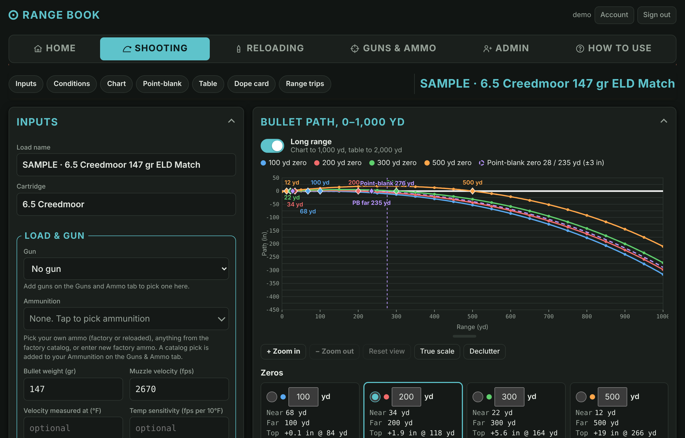
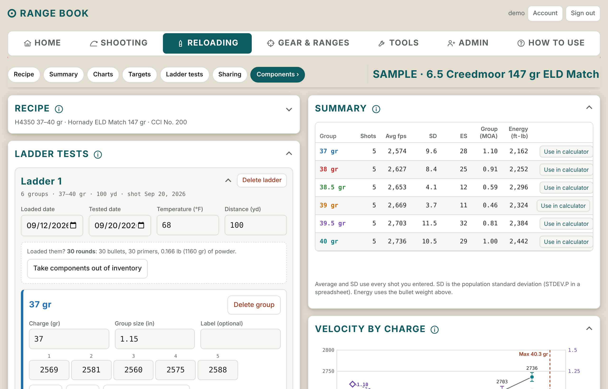
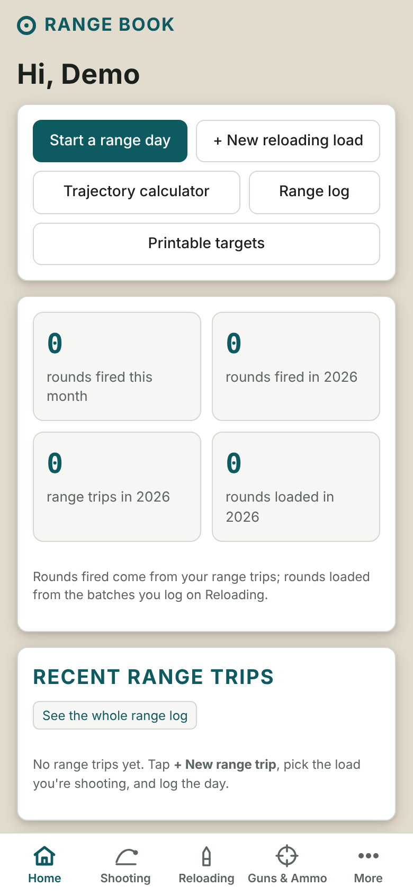
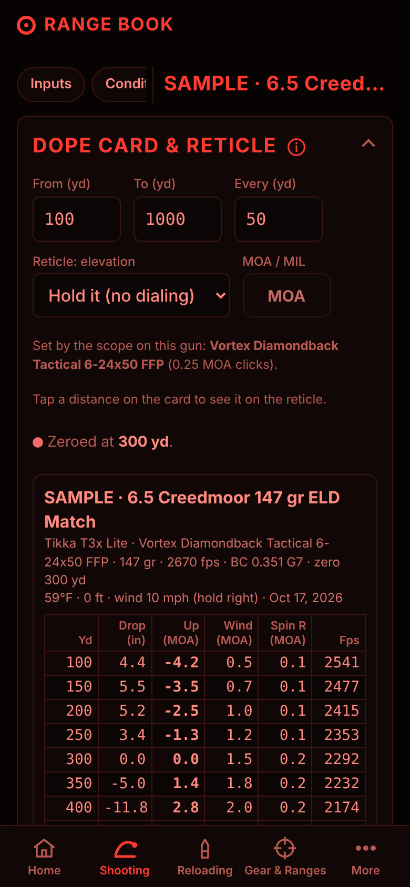
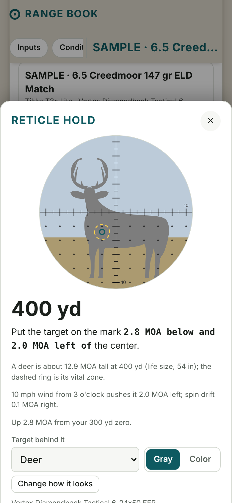
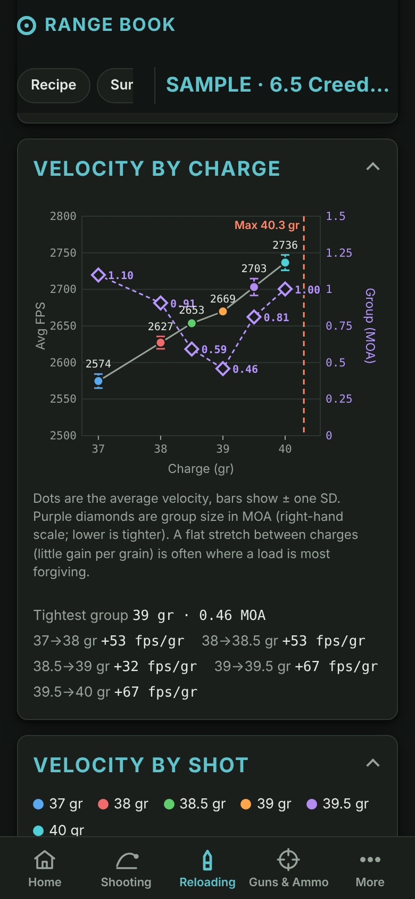
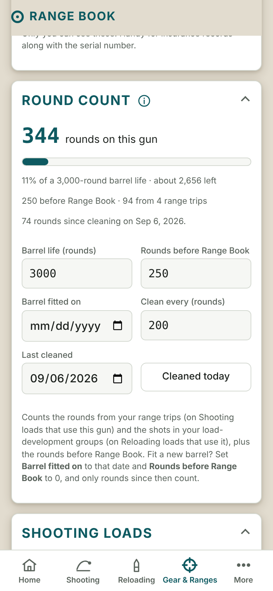
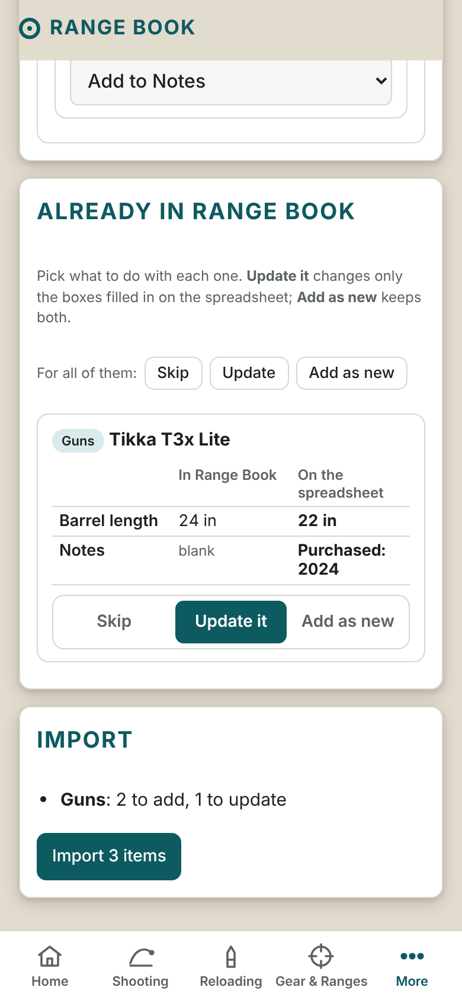

# Range Book

A self-hosted ballistics calculator and reloading log, with a sign-in for each person. Run it on your own server (Unraid, a NAS, a Raspberry Pi or any computer with Docker) and use it from your phone as a home-screen app, even at the range with no signal.

Free software under the [GNU AGPL-3.0](#license).

> **Beta:** Range Book is still in beta, and not everything has been tested thoroughly. Double-check anything that matters (charges, load data, dope) against your load manual and your own results. Each new version shows this notice once in the app, and it has to be dismissed.

<p>
  
  
</p>
<p>
  
  
  
</p>
<p>
  
  
  
</p>

<sub>Screenshots use made-up data, including the built-in SAMPLE load.</sub>

> **Safety first.** Range Book is a notebook and a calculator, not a load manual. A new install comes with a made-up **SAMPLE** 6.5 Creedmoor load to show how things work. Its numbers aren't real load data. Always work from a current published load manual for your exact components.

## What it does

- **Home:** **Start a range day** (pick the gun, then the profile or ammo, or factory ammo from the catalog; it opens a trip with today's weather), low-stock, barrel-life and cleaning alerts, rounds fired this month and year, recent trips and loads, and your most used guns (favorites first, with their photos).
- **Shooting:** profiles (a gun and the ammo you shoot in it, with its zero and conditions; named "gun - ammo" unless you name them) in a G1/G7 trajectory calculator (a 3DOF point-mass solver) showing your point-blank zero and up to three more zeros on a short (200 yd), medium (400 yd) or long (1,000 yd) chart, a range table (with a key for its lines), a printable **dope card** and a full-screen **Field mode**. An **Effective range** button on the chart marks where the bullet drops below a minimum speed or energy you set (the maker's published minimum expansion speed, kept with the bullet or factory load in the Library, is offered when Range Book knows the ammo), on the chart, the range table, the dope card and Field mode. Wind speed and o'clock direction with optional wind brackets, uphill/downhill angle, spin drift (with a plastic-tip correction to the stability number), Coriolis on the long-range chart (latitude from your location or a saved range, direction of fire from the phone's compass), and powder temperature sensitivity learned from your range trips. True up your muzzle velocity from a real long-range hit, tap any distance on the dope card to see the hold drawn on a reticle (MOA or MIL) with a life-size **target behind it** (a 4–12 inch steel circle, a 2/3 IPSC, or an elk, deer, pronghorn, coyote or prairie dog in gray or color, with its vital zone marked, sized for the distance and scope power), and save the ranges you shoot (Gear & Ranges → Ranges) with every target's distance and angle.
- **Chronograph checks:** a velocity that's way off from the rest of its string (a misread or a typo) is shown in red with a note, in ladders, range trips and the chronograph import check.
- **Tools › Library:** every built-in list in one place (bullets, cartridges, powders, primers, factory ammo, scopes, red dots and suppressors), each searchable. Tap any entry to see all of it, fix a number for your own use (with **Revert** to put the maker's back), or add it to your gear or components. Home's **Built in Library** card opens it.
- **Paste or drop pictures:** on a computer, paste a copied picture or screenshot (Ctrl+V / ⌘V) or drag a file onto the page, and it goes to the + Add button on that screen (photos, reticle pictures, documents, imports).
- **One way to add things:** every **+ Add** button for something Range Book has a list of (scopes, red dots, suppressors, factory ammo, bullets, powders, primers) opens the same screen: search, tap yours from tiles grouped by maker or caliber, or enter it yourself.
- **Reloading › Reference:** every cartridge's bullet diameter, case length, trim-to length, overall length and primer size; cartridges grouped by bullet diameter; a powder burn-rate order (about 250 powders); a pressure-signs guide; and a glossary.
- **Reloading:** recipes with **ladder tests** (each ladder with its own dates, temperature, distance, groups and target photos), a ladder planner and printable ladder labels, chronograph imports (LabRadar, Garmin Xero, MagnetoSpeed, RangeCraft), velocity-by-charge and velocity-by-shot charts, a max-charge warning, pressure-sign notes on each charge, **Live target** (a phone on your spotting scope marks each shot on a printed target as it lands, works on any target, matches each hole to its chronograph velocity, can show your scope's reticle over the target to scale with your hold, and you can watch and control it from an iPad, or start it on the iPad and use the phone as its camera), **Combine matching charges** across ladders, a working charge and load sheet, **Compare loads**, and ammo box labels.
- **Components:** bullets (a built-in list of about 1,000 from Berger, Hornady, Sierra, Nosler, Barnes, Speer, Lapua, Berry's, X-Treme and CamPro, with weights, diameters, BCs and lengths from the makers' own data), powders (a built-in list of about 150), primers (a built-in list of 46) and brass lots, with on-hand inventory that goes down as you load, prices and a cost per round.
- **Gear & Ranges** (Guns · Optics · Suppressors · Magazines · Ammo · Inventory · Ranges · Notes): **magazines** one per entry with a Mag # (the number you mark on it), grouped by maker and model, with the guns each fits and a log of jams and other problems; then: **notes** with pictures and files, each of which can be locked in the encrypted vault; **suppressors** (each with a picture; pick from a built-in list of about 430 from 26 makers, plus popular 3D-printed Form 1 designs with their caliber ratings, size, full auto rating and barrel-length limits) with serial numbers, tax stamp dates and their own round counts (each gun with a threaded barrel lists the suppressors used on it, offering only ones rated for its cartridge or bigger; each Shooting profile picks the one it's shot with and the one it was zeroed with on its **Suppressor** card), and a warning when one is listed for a gun whose bullet is bigger than it's rated for; an **inventory** of supplies with low-stock warnings and equipment with serials and photos, with check-or-replace-by reminders; a **document vault** that encrypts tax stamps and receipts on your device with a passphrase only you know (and can keep a locked copy on your phone to open with no signal); gun records (star your favorites to keep them on top, and give them a nickname if you like) (rifle, pistol or shotgun, and listed by type) with photos, round counts, **lowers and uppers** you put together into guns (one gun can have several uppers, and you pick which one you're shooting), swappable **barrels** for complete guns (Shooting and Reloading ask which one you're using), each with its own round count, barrel life and cleaning reminders; **scopes** (each with a picture; a list of about 130 popular ones with their published specs, including MIL reticles with MOA turrets) that set each gun's MOA or MIL, second focal plane holds, and a reticle you can make look like yours or replace with a picture of your own (Range Book finds the crosshair in it and, for scopes in its list, the mark that sets the scale); reloaded and factory ammo inventory, with a catalog of about 355 factory loads from 14 makers. A list of about 115 rifle, handgun and rimfire **cartridges** (find one by any name, like "3006" or "7.62 NATO") fills in the bullet diameter and shows the SAAMI/C.I.P. maximum case length and overall length (see the whole list, fix it or add your own under Tools › Library › Cartridges), and Range Book warns when ammo doesn't fit a gun (it knows the safe one-way pairs, like 38 Special in a 357 Magnum or 223 in a 5.56, flags ammo with a bigger bullet than the bore as dangerous, and asks you to check first for +P ammo and 9mm NATO in a 9mm Luger gun), when a bullet doesn't fit the cartridge, and when COAL is over the maximum. Recipes and ammo can be marked **subsonic**, which tags them (and the Shooting profiles that use them) in the lists. **Ranges** keep their targets (with the dial and wind for each one with any profile) and an **address**: Range Book finds it on the map (or you tap **I'm here now** at the range) and shows today's weather there (temperature, humidity, dew point, air pressure, pressure and density altitude, elevation and wind), which you can put on a profile or a range trip with one tap, plus sunrise and sunset for today and tomorrow (worked out on the device, no signal needed; range trips show them for the trip's date). They're the times only, not legal shooting or hunting hours.
- **Optics:** scopes (from a list of about 130, with their reticle marks, and bullet drop reticles marked as such; for those, a Shooting profile can show which distance each bullet drop mark lines up with for your load, from the maker's mark positions in the Library for 14 of them, or ones you type in from the manual) plus red dots, holographic and prism sights (from a list of about 75), grouped by kind, each with an optional nickname. On a gun with a red dot, the dope card gives holds in inches and dot widths, and the sight picture shows the dot over the target to scale.
- **Your own layout:** arrange (and hide) Home's cards, choose the four tabs on the phone's bottom bar, put a profile's cards and a range's targets in your order, and drag the Tools tiles around. It's saved to your account.
- **Tools:** quick calculators that don't save anything (drag the tiles into your own order): **compare trajectories** (up to six bullets on one chart: path, dial, wind drift, speed or energy), a **chronograph import check** (see how an export reads before importing it), a standalone **trajectory calculator** (the full Shooting calculator, chart, range table and dope card included, without making a profile; save it as one if you like), twist & bullet stability (also a warning on any Shooting profile whose twist is too slow), MOA/MIL/inches, powder per container and cost per round, unit conversions, **Hit chance** (your odds of a first-round hit, and what would help most), printable targets (Letter, 11 × 17, and bigger ones made of two Letter pages taped together), and **Live target** on its own (no load needed: saved targets can be moved into a range trip or a ladder later, or shared as a marked picture).
- **Training and shot timer:** Tools › Shot timer beeps after a random or fixed delay, then hears each shot with the phone's microphone and shows the first shot and every split, with an optional par beep (its own beeps are told apart from shots by their pitch). Sensitivity, an echo filter, dry fire (beeps only) and a Bluetooth speaker with a measured delay. The **Training** tab keeps training profiles (a gun and its ammo, barrel or suppressor), each with sessions: one per day of practice with every drill you ran (six common drills built in, plus your own), a progress chart per drill and a side-by-side comparison of any two sessions. Session rounds count toward the gun, barrel, suppressor and ammo like range trips, but stay out of the Range log. The microphone needs https; nothing is recorded.
- **Range trips and Range log:** conditions, rounds fired, the cold-bore shot (each gun keeps a cold-bore log), chronograph strings and target photos you can measure (printed targets with corner squares are measured automatically). A trip lays all its measured groups on one target, and each profile has an **All your groups** card with every group from every trip (mean radius, typical group, average center), lined up on the aim point or on each group's center. Mark a trip's groups and chronograph strings as **suppressor on or off** and Range Book works out that gun and suppressor's point-of-impact and speed shift; a profile's **Suppressor** card applies it when you shoot it differently from how you zeroed. Each trip prints as a PDF report.
- **For everyone on your server:** a short, skippable tour the first time someone signs in, a **Help** button on each page that opens the matching part of How to Use, and an ⓘ on most cards for a quick how-to; each person's data is private; loads can be shared view-only with specific people. Admins add people, reset passwords, check backups and can cap how much each person stores on the server (one limit for everyone, with a different one for anyone who needs it). The first admin is the **super admin**: other admins can't delete, demote or reset the password of that account, and only the super admin can download or restore the whole site or hand the role to another admin. An optional guest mode lets people try it without an account. Box photos of catalog ammo, and factory loads people choose to share, are seen by everyone by default; an admin can turn that sharing off (useful on a big public server).
- **Phone-friendly:** works offline (over https), pull to refresh, Light, Dark and Red Night themes (plus color themes and an optional faint camo background), three text sizes, imperial or metric. Changes made on several devices (including offline ones) are merged when they sync, keeping the newest edit to each item.
- **Your data is yours:** a one-file backup with photos, Excel and PDF exports, and Import to bring a backup or Excel export back in (or move to another server). **Import from a spreadsheet** adds guns (including ones built from a lower and an upper), optics (scopes, red dots, holographic and prism sights), lowers, uppers, barrels, magazines, factory ammo and components from a downloadable template or your own .xlsx or .csv, asking about unrecognized columns or values and about duplicates before saving.

---

## Install

Range Book runs as one Docker container. All your data lives in one folder you choose (`/data` inside the container).

Don't have a server? See [No server? Here's how](#no-server-heres-how).

### Unraid

**With the template (a form in the Docker tab):** open the Unraid **Terminal** (the `>_` icon) and run

```sh
wget -O /boot/config/plugins/dockerMan/templates-user/my-rangebook.xml \
  https://raw.githubusercontent.com/saoneill01-a11y/rangebook/main/unraid/rangebook.xml
```

then go to **Docker → Add Container**, pick **rangebook** under **Template**, check the time zone and click **Apply**.

**Or from the terminal:**

```sh
docker run -d --name rangebook --restart unless-stopped \
  -p 9090:9090 \
  -e TZ=America/Chicago \
  -v /mnt/user/appdata/rangebook:/data \
  ghcr.io/saoneill01-a11y/rangebook:latest
```

### Docker Compose (any server)

Download [`docker-compose.yml`](docker-compose.yml), set your time zone in it, then:

```sh
docker compose up -d
```

### Docker (any server)

```sh
docker run -d --name rangebook --restart unless-stopped \
  -p 9090:9090 \
  -e TZ=America/Chicago \
  -v /path/to/rangebook-data:/data \
  ghcr.io/saoneill01-a11y/rangebook:latest
```

- Use your own [time zone](https://en.wikipedia.org/wiki/List_of_tz_database_time_zones) for `TZ`.
- Change the first `9090` (for example to `9095:9090`) if port 9090 is already used.
- Images are built for regular PCs and servers (amd64) and ARM (Raspberry Pi 4/5, Apple-silicon Macs).

### First start

1. Open `http://YOUR-SERVER-IP:9090`.
2. A brand-new Range Book shows a **Welcome** page. Enter your name, a username and a password: that becomes the admin account. **Do this right away**, because until an account exists, anyone who can reach the page could create it. (Or set `ADMIN_USERNAME` and `ADMIN_PASSWORD` and the account is made for you.)
3. Add people under **Admin → Add a user**. Each gets a temporary password and chooses their own the first time they sign in.
4. On an iPhone, open the address in Safari and tap **Share → Add to Home Screen**. On Android, use Chrome's **Add to Home screen**.

### Build it yourself instead

```sh
git clone https://github.com/saoneill01-a11y/rangebook.git
cd rangebook
docker build -t rangebook .
docker run -d --name rangebook --restart unless-stopped -p 9090:9090 -e TZ=America/Chicago -v /path/to/rangebook-data:/data rangebook
```

There's no build step and no npm packages. To run it without Docker, install Node.js 22 or newer and run `DATA_DIR=./data node server.js`.

### No server? Here's how

Range Book needs a computer that's always on, to keep your database and target photos and to answer your phone. You don't need to buy one to start. From easiest to most work:

1. **Ask someone who already runs Range Book for an account.** One Range Book holds many people, and each person's data is private. The admin adds you under **Admin → Add a user**. It costs you nothing and there's nothing to set up.
2. **A computer you already own (free).** Install [Docker Desktop](https://www.docker.com/products/docker-desktop/) on a Windows PC or Mac, run the [`docker run` command](#docker-any-server) above, and open `http://localhost:9090`. To use it from your phone away from home, add [Tailscale](https://tailscale.com/) or a Cloudflare Tunnel (see [Using it away from home](#using-it-away-from-home)). The computer has to stay on and not go to sleep.
3. **A Raspberry Pi 5 (a one-time cost, roughly $100 for the board, power supply and storage).** It sits on a shelf, uses very little power, and runs Range Book easily. Install Raspberry Pi OS (64-bit) and Docker, then use the same `docker run` command and a tunnel. This is the best "set it and forget it" choice.
4. **A small rented server in the cloud (about $5–8 a month as of 2026).** Any provider that rents a small Linux server with Docker works; 1 GB of memory and 10 GB of disk is plenty for one family. Choose a provider with a disk that keeps your files (services like Netlify or Vercel won't work: Range Book has to keep files and run all the time). Some providers have free tiers, but their limits change often, so check before you rely on one.

Whichever you choose, turn on an https address (a tunnel or a reverse proxy, below) so the app works offline on your phone, the camera works for Live target and the document vault can encrypt (browsers only allow it over https or on localhost), and keep a copy of your backups somewhere else.

---

## Using it away from home

Don't forward port 9090 on your router. Use one of these instead:

- **VPN (simplest):** WireGuard or Tailscale. Your phone connects home, then you use the same `http://YOUR-SERVER-IP:9090` address.
- **Reverse proxy with https:** Nginx Proxy Manager, SWAG, Caddy or Traefik. Add `-e COOKIE_SECURE=true -e TRUST_PROXY=true` to the container.
- **Cloudflare Tunnel:** gives you an https address with nothing opened on your router. Point the tunnel at `http://YOUR-SERVER-IP:9090` and add `-e COOKIE_SECURE=true -e TRUST_PROXY=true`. You can put Cloudflare Access in front of it for extra protection.

An **https** address is what lets a phone use Range Book **offline**, share its location for **Use the weather where I am** and **I'm here now**, keep the screen awake in **Field mode**, and use the **Copy** buttons. On a plain `http://` home-network address everything else works the same, and with `COOKIE_SECURE=true` you can sign in on both addresses. Plain `http://` isn't encrypted, so use it only on a network you trust.

Weather and range addresses are looked up straight from the browser: the weather from [Open-Meteo](https://open-meteo.com) and addresses from [OpenStreetMap](https://nominatim.openstreetmap.org). Only the coordinates or the address you typed are sent, never your name or account.

## Settings

| Setting | Default | What it does |
|---|---|---|
| `TZ` | UTC | Your time zone, for dates and the nightly backup time |
| `ADMIN_USERNAME` | *(blank)* | Suggested username on the first-run Welcome page (or the admin's username when `ADMIN_PASSWORD` is set; `admin` if blank) |
| `ADMIN_PASSWORD` | *(blank)* | Creates the admin account on first start with this password, skipping the Welcome page |
| `PUID` / `PGID` | `99` / `100` | Owner of the data folder (Unraid's nobody:users). On other systems, use your user's IDs (`id -u` / `id -g`) |
| `PORT` | `9090` | Port inside the container |
| `SESSION_DAYS` | `30` | How long people stay signed in |
| `COOKIE_SECURE` | `false` | Set `true` when you reach it through https. The cookie is then https-only on https visits, and a home-network `http://` address still works |
| `TRUST_PROXY` | `false` | Set `true` behind a reverse proxy or tunnel, so sign-in limits see real addresses |
| `IMPORT_SEED` | `true` | A new install's first account gets a made-up sample 6.5 Creedmoor ladder to show how things work. Set `false` to start with an empty Reloading list |
| `RESET_ADMIN_PASSWORD` | *(blank)* | Emergency reset for the admin account (see below) |
| `BACKUP_HOUR` | `3` | Hour of the night (0–23, server time) for the automatic backup |
| `BACKUP_KEEP` | `14` | How many daily backups to keep |
| `BACKUPS` | `true` | Set `false` to turn off the automatic backups |
| `SOURCE_URL` | this project | Where people can get the source code of your copy, shown under **How to Use → License**. If you run a changed version for other people, set this to where your changes are published (see [License](#license)) |

## Backups

**Your own copy:** everyone can tap **Account → Download backup** for a .zip of everything in their account, photos included, and bring it back with **Account → Import** on this or any other Range Book. Import adds to the account and skips anything already there, so it never deletes or doubles anything. Excel exports can be imported too (without photos). To add guns, optics, lowers, uppers, barrels, magazines, factory ammo or components from your own spreadsheet, use **Account → Import from a spreadsheet** (there's a template to download). Admins can download any person's backup from the Admin page.

**The whole server:** everything is in your data folder: the database `rangebook.db` and the `photos` folder.

**Automatic:** every night at 3 am (and when the container starts, if there isn't one for today yet), Range Book saves a full copy in `backups/<date>/` inside the data folder, with the database and the photos. The last 14 are kept. The **Admin** page shows the last backup and has a **Back up now** button. Photos in each backup are hard links, so they take almost no extra space.

These backups sit on the same disk as your data, so they protect against mistakes, not a failed drive. Copy the data folder somewhere else too (on Unraid, the Appdata Backup plugin does this).

**From the Admin page (super admin only):** **Download site backup** saves the whole site (every account, all the data, photos, videos and files) in one `.tar.gz` file on whatever device you're using, so you can keep a copy off the server without logging in to it. To bring it back, start a fresh Range Book (an empty data folder), sign in with the account it asks you to set up, and on the Admin page use **Restore the whole site** with that file (or a `.zip` of a nightly backup folder). The upload goes in pieces, so it works through a Cloudflare Tunnel too. Every account comes back with its own password. It only runs on a fresh install (one account, no pictures or files), and what was there is kept in `pre-restore-<time>/` in the data folder.

**Nightly copy to another computer (super admin only):** if Range Book runs on a cloud host, another computer (say, an Unraid server at home) can download the whole-site backup on a schedule. On the Admin page, under **Nightly copy to another computer**, tap **Turn on**. It shows a backup key once, plus a ready-made script with the key and your site's address filled in. On Unraid, install **User Scripts** from Apps, add a new script, paste it in, change `DEST` to the folder you want and set it to run daily. The script downloads `/api/backup/site.tar.gz` with the key in an `Authorization: Bearer` header, checks the file, and keeps the newest 30. Only a hash of the key is stored; anyone with the key can download everything, so tap **Make a new key** (the old one stops working) or **Turn off** if it gets out. Ten wrong keys from one address lock that address out for 15 minutes.

**Encrypted site backups (optional, super admin only):** under **Encrypt site backups** on the Admin page, set a passphrase (12+ characters) and every site backup you download, by hand or with the nightly copy, is encrypted (`.tar.gz.enc`). **Restore the whole site** asks for the passphrase; a wrong one can be retried without uploading the file again. Range Book keeps only a key derived from the passphrase and can't recover a lost one, so store it in a password manager. Backups in the server's own `backups/` folder aren't encrypted (they're on the server already). The format is standard, so a file can be opened without Range Book too: `RBENC` + byte `0x01`, a 16-byte salt, a 12-byte IV, then AES-256-GCM of the `.tar.gz` with the 16-byte tag at the end; the key is scrypt(passphrase, salt, N=32768, r=8, p=1, 32 bytes).

**To restore** a nightly backup by hand:

```sh
docker stop rangebook
cd /path/to/rangebook-data
mv rangebook.db rangebook.db.old; rm -f rangebook.db-wal rangebook.db-shm
cp backups/2026-10-12/rangebook.db .
cp -n backups/2026-10-12/photos/* photos/
docker start rangebook
```

Everyone can also download their own data as an Excel workbook or a PDF report from the **Account** page.

## Updating

```sh
docker pull ghcr.io/saoneill01-a11y/rangebook:latest
docker stop rangebook && docker rm rangebook
```

Then run your `docker run` command again (or `docker compose pull && docker compose up -d`; on Unraid, **Check for Updates** in the Docker tab). Your data folder isn't touched. Open apps show a **Reload now** prompt when the server has a new version, and **More → What's new** lists the changes.

## Locked out of the admin account?

Another admin can reset it from the Admin page (unless it's the super admin's account: other admins can't touch that one). If you're the only admin, or you're the super admin, recreate the container once with `-e RESET_ADMIN_PASSWORD=some-temp-pass` added, sign in with that password and choose a new one. That account also becomes the super admin again. Then recreate it again without that setting, so it doesn't reset on the next restart.

## Security notes

- Passwords are stored as salted scrypt hashes, never in plain text.
- After 10 wrong passwords for an account from one address, sign-in for it pauses for 15 minutes.
- Resetting someone's password or turning their account off signs them out everywhere.
- Deleting a user deletes their loads, profiles and photos. Turning an account off keeps everything and can be undone.
- To report a security problem privately, see [SECURITY.md](SECURITY.md).
- Everyone sees a safety and no-liability notice the first time they sign in. It isn't legal advice; if you open your server to the public, have someone qualified look it over.

## Offline chronograph import

Reading RangeCraft and Garmin spreadsheet files uses a free library (SheetJS) that the browser downloads from cdnjs the first time. To avoid that, see [`public/vendor/README.txt`](public/vendor/README.txt).

## Contributing

Bug reports, ideas and pull requests are welcome. See [CONTRIBUTING.md](CONTRIBUTING.md).

## Contact

Website: [rangebook.org](https://rangebook.org)

Questions, ideas or help: **[hello@rangebook.org](mailto:hello@rangebook.org)** (or **More › Account › Feedback and ideas** in the app, which fills in your version). Found a security problem? Please email **[security@rangebook.org](mailto:security@rangebook.org)** instead of opening a public issue; see [SECURITY.md](SECURITY.md).

## License

Range Book is free software. Copyright © 2026 Sean O'Neill.

It's licensed under the **GNU Affero General Public License, version 3 or later** (AGPL-3.0-or-later). See [LICENSE](LICENSE). In plain terms:

- Anyone can download, use, change and share it, for free, including for a business.
- If you share a changed version, or run one as a website for other people, you must make your source code available to those people under the same license. A copy or fork can't be made closed or private.
- It comes with no warranty.

If you host a changed version, set `SOURCE_URL` so the app links people to your source code.

Range Book loads the SheetJS spreadsheet reader (Apache-2.0) from cdnjs for chronograph imports, and its fonts from Google Fonts (SIL Open Font License). Neither is bundled with this code.
